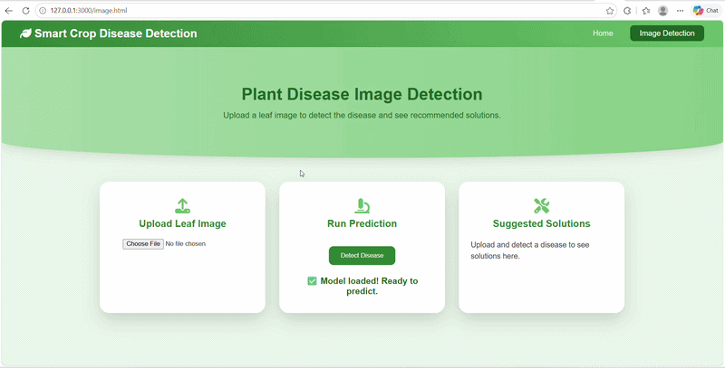

# Weather-Based Smart Crop Disease Prediction and Detection

Weather-Based Smart Crop Disease Prediction and Detection, aims to develop an intelligent system that integrates machine learning, image processing, and real-time weather data to accurately predict and detect crop diseases at an early stage. 

## Demo
